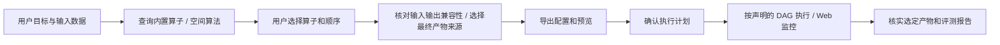
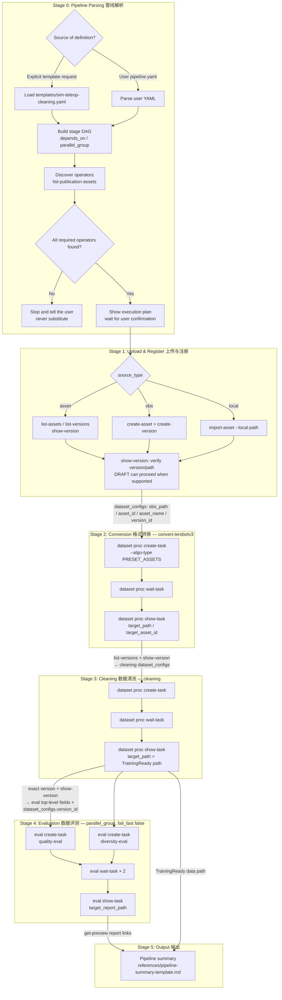
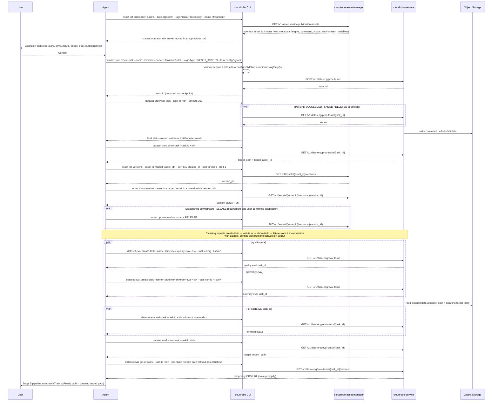
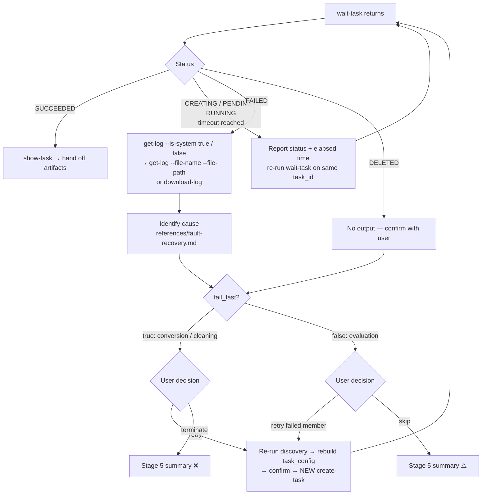

# Dataflow Diagram 数据流图

## Custom Workflow 自定义工作流

无明确需求时从目标开始提问，保留空白草案。以下编号阶段仅展示可主动选择的内置模板，
不能由这些示意图推导出所有自定义工作流都要转换、清洗或评测。

## Built-in Template Overview 内置模板总览

> **Partial pipeline**: when the user already has converted data, the run starts at
> Stage 3 with a user-supplied `target_path` / `target_asset_id` / `version_id` and asset name.

## Stage Submit / Poll / Handoff Sequence 提交-轮询-交接时序

## Failure Handling Flow 故障处理流程

## CLI Commands and API Paths CLI命令与API路径汇总

### Discovery & Registration 发现与注册 (cloudrobo-asset-manager)

| Stage | CLI command | Method | API path |
|-------|-------------|--------|----------|
| 0, 2–4 | `cloudrobo asset list-publication-assets --type algorithm --tags "Data Processing" \| "Data Evaluation" --name <fragment>` | GET | `/v1/asset-service/publication-assets` |
| 0, 1 | `cloudrobo workspace current` | — | Local config `~/.cloudrobo/workspace.json` (`asset_catalog_id`) |
| 1 (asset) | `cloudrobo asset show-asset --asset-id <id>` | GET | `/v1/assets/{asset_id}` |
| 1 (obs) | `cloudrobo asset create-asset --catalog-id <id> --name <name> --type dataset --ext-metadata <json>` | POST | `/v1/assets` |
| 1 (obs) | `cloudrobo asset create-version --asset-id <id> --url <obs_path>` | POST | `/v1/assets/{asset_id}/versions` |
| 1 (local) | `cloudrobo asset import-asset --catalog-id <id> --type dataset --local-path <dir> --name <name> --ext-metadata '{"annotation_status":true}'` | POST + OBS upload | `/v1/assets`, `/v1/assets/{asset_id}/versions` (composite) |
| 1–4 | `cloudrobo asset list-versions --asset-id <id> --sort-key created_at --sort-dir desc --limit 1` | GET | `/v1/assets/{asset_id}/versions` |
| 1–4 | `cloudrobo asset show-version --asset-id <id> --version-id <vid>` | GET | `/v1/assets/{asset_id}/versions/{version_id}` |
| 1–4 | `cloudrobo asset update-version --asset-id <id> --version-id <vid> --status RELEASE` | PUT | `/v1/assets/{asset_id}/versions/{version_id}` |

### proc-tasks (conversion / cleaning) — cloudrobo-service

| CLI command | Method | API path |
|-------------|--------|----------|
| `cloudrobo dataset proc create-task --name --algo-type --task-config [--workspace-id]` | POST | `/v1/data-eng/proc-tasks` |
| `cloudrobo dataset proc list-tasks [--name <pipeline_name>]` | GET | `/v1/data-eng/proc-tasks` |
| `cloudrobo dataset proc show-task --task-id` | GET | `/v1/data-eng/proc-tasks/{task_id}` |
| `cloudrobo dataset proc wait-task --task-id [--timeout] [--interval]` | GET (polling) | `/v1/data-eng/proc-tasks/{task_id}` |
| `cloudrobo dataset proc get-log --task-id --is-system true\|false` | GET | `/v1/data-eng/proc-tasks/{task_id}/logs` |
| `cloudrobo dataset proc get-log --task-id --file-name --file-path [--all]` | GET | `/v1/data-eng/proc-tasks/{task_id}/logs/{file_name}` |
| `cloudrobo dataset proc download-log --task-id --file-name --file-path` | GET | `/v1/data-eng/proc-tasks/{task_id}/logs/{file_name}/download` |
| `cloudrobo dataset proc get-frames --task-id --prefix` | GET | `/v1/data-eng/proc-tasks/{task_id}/frames?prefix=` |
| `cloudrobo dataset proc get-preview --task-id --file-name` | GET | `/v1/data-eng/proc-tasks/{task_id}/preview` |

### eval-tasks (quality / diversity) — cloudrobo-service

| CLI command | Method | API path |
|-------------|--------|----------|
| `cloudrobo dataset eval create-task --name --task-config [--workspace-id]` (no `--algo-type`) | POST | `/v1/data-eng/eval-tasks` |
| `cloudrobo dataset eval list-tasks [--name <pipeline_name>]` | GET | `/v1/data-eng/eval-tasks` |
| `cloudrobo dataset eval show-task --task-id` | GET | `/v1/data-eng/eval-tasks/{task_id}` |
| `cloudrobo dataset eval wait-task --task-id [--timeout] [--interval]` | GET (polling) | `/v1/data-eng/eval-tasks/{task_id}` |
| `cloudrobo dataset eval get-log --task-id --is-system true\|false` | GET | `/v1/data-eng/eval-tasks/{task_id}/logs` |
| `cloudrobo dataset eval get-log --task-id --file-name --file-path [--all]` | GET | `/v1/data-eng/eval-tasks/{task_id}/logs/{file_name}` |
| `cloudrobo dataset eval download-log --task-id --file-name --file-path` | GET | `/v1/data-eng/eval-tasks/{task_id}/logs/{file_name}/download` |
| `cloudrobo dataset eval get-preview --task-id --file-name [--is-download]` | GET | `/v1/data-eng/eval-tasks/{task_id}/preview` |

> Terminal states for both task types: `SUCCEEDED`, `FAILED`, `DELETED`. `wait-task`
> defaults to `--timeout 300` / `--interval 10`. When the timeout elapses it returns the
> last status without failing, so re-run it on the same `task_id` instead of resubmitting.
