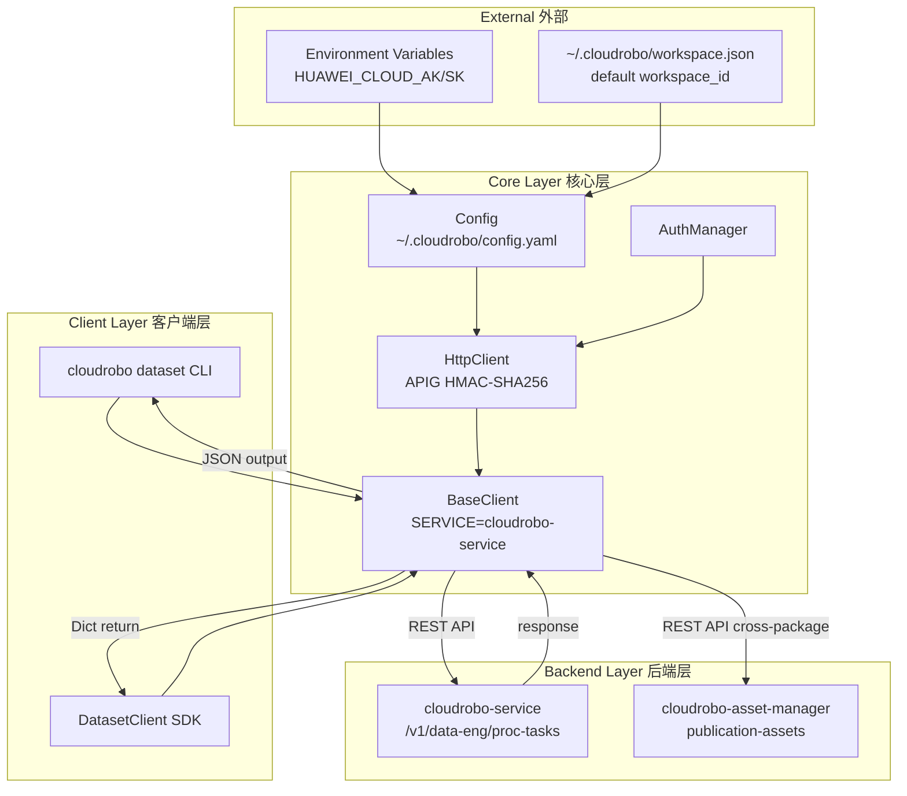
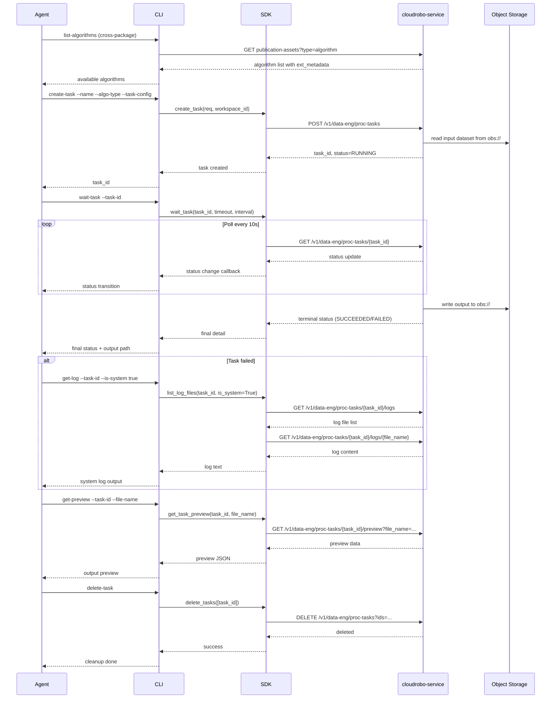
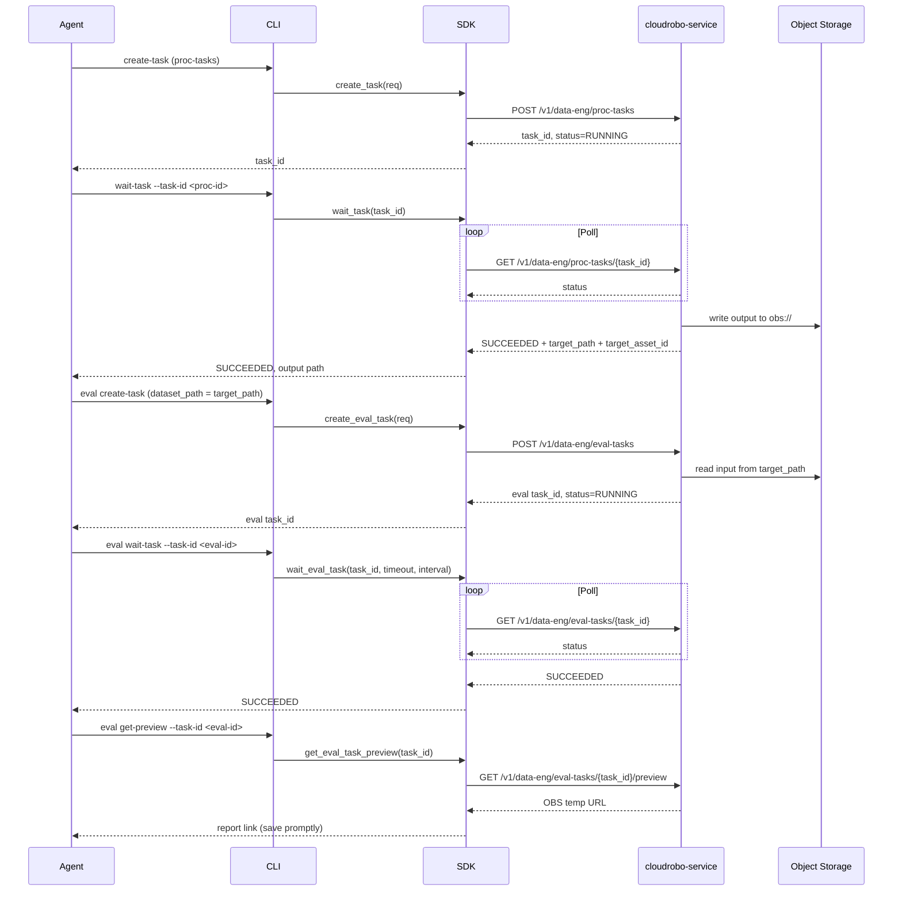

# Dataflow Diagram 数据流图

## Architecture Overview 架构概览



## Task Lifecycle Flow 任务生命周期流程



## Log Retrieval Flow 日志获取流程

```mermaid
flowchart TD
    A[Agent requests logs] --> B{is_system?}
    B -->|true| C[GET /logs?is_system=true]
    B -->|false| D[GET /logs?is_system=false]
    C --> E[Parse file_name + file_path]
    D --> E
    E --> F{--all flag?}
    F -->|no| G[get_task_log_tail<br/>latest 64KB]
    F -->|yes| H[get_task_log<br/>full content]
    G --> I[GET /logs/{file_name}<br/>start_byte=0&end_byte=65536]
    H --> J[GET /logs/{file_name}<br/>start_byte=0&end_byte=1000000]
    I --> K{total_size < 64KB?}
    K -->|yes| L[Return partial content]
    K -->|no| M[GET /logs/{file_name}<br/>start_byte=total-64KB]
    M --> L
    J --> L
    L --> N[Return log content to Agent]
```

## Pipeline Flow (proc-tasks → eval-tasks) 任务编排流程



## API Path Summary API路径汇总

### proc-tasks

| Operation | Method | Path |
|-----------|--------|------|
| Create task | POST | `/v1/data-eng/proc-tasks` |
| List tasks | GET | `/v1/data-eng/proc-tasks` |
| Show task | GET | `/v1/data-eng/proc-tasks/{task_id}` |
| Update task | PATCH | `/v1/data-eng/proc-tasks/{task_id}` |
| Delete tasks | DELETE | `/v1/data-eng/proc-tasks?ids=` |
| Copy task | POST | `/v1/data-eng/proc-tasks/{task_id}/copy` |
| List log files | GET | `/v1/data-eng/proc-tasks/{task_id}/logs` |
| Get log content | GET | `/v1/data-eng/proc-tasks/{task_id}/logs/{file_name}` |
| Download log | GET | `/v1/data-eng/proc-tasks/{task_id}/logs/{file_name}/download` |
| Get frames | GET | `/v1/data-eng/proc-tasks/{task_id}/frames?prefix=` |
| Get preview | GET | `/v1/data-eng/proc-tasks/{task_id}/preview` |
| Get resource usage | GET | `/v1/data-eng/proc-tasks/{task_id}/resource-usage` |
| Get events | GET | `/v1/data-eng/proc-tasks/{task_id}/events` |

### eval-tasks

| Operation | Method | Path |
|-----------|--------|------|
| Create eval task | POST | `/v1/data-eng/eval-tasks` |
| List eval tasks | GET | `/v1/data-eng/eval-tasks` |
| Show eval task | GET | `/v1/data-eng/eval-tasks/{task_id}` |
| Wait eval task (polled) | GET | `/v1/data-eng/eval-tasks/{task_id}` |
| Update eval task | PATCH | `/v1/data-eng/eval-tasks/{task_id}` |
| Delete eval task | DELETE | `/v1/data-eng/eval-tasks/{task_id}` |
| Copy eval task | POST | `/v1/data-eng/eval-tasks/{task_id}/copy` |
| List eval log files | GET | `/v1/data-eng/eval-tasks/{task_id}/logs` |
| Get eval log content | GET | `/v1/data-eng/eval-tasks/{task_id}/logs/{file_name}` |
| Download eval log | GET | `/v1/data-eng/eval-tasks/{task_id}/logs/{file_name}/download` |
| Get eval preview | GET | `/v1/data-eng/eval-tasks/{task_id}/preview` |
| Get eval events | GET | `/v1/data-eng/eval-tasks/{task_id}/events` |

### cloudrobo-asset-manager (assets — custom-operator onboarding & algorithm discovery)

Base URL: `https://cloudrobo-gallery.{region}.myhuaweicloud.com`. All paths are derived
from the SDK source code (`cloudrobo_asset/client.py`) via `_url()` calls — never
inferred. SDK source line references: `update_asset` (L43), `create_asset_version`
(L56), `list_asset_versions` (L59), `show_asset_version` (L62), `update_asset_version`
(L66). Verify with `grep "_url(" <cloudrobo_asset/client.py>`.

| Operation | Method | Path | SDK Method |
|-----------|--------|------|------------|
| Create asset (image / algorithm / dataset) | POST | `/v1/assets` | `AssetClient.create_asset(req)` |
| Update asset (algorithm `engine.image_url` / `code_dir`) | PUT | `/v1/assets/{asset_id}` | `AssetClient.update_asset(asset_id, req)` |
| Show asset | GET | `/v1/assets/{asset_id}` | `AssetClient.show_asset(asset_id)` |
| List assets | GET | `/v1/assets` | `AssetClient.list_assets(**params)` |
| Create asset version (image / dataset re-submission) | POST | `/v1/assets/{asset_id}/versions` | `AssetClient.create_asset_version(asset_id, req)` |
| List asset versions | GET | `/v1/assets/{asset_id}/versions` | `AssetClient.list_asset_versions(asset_id, **params)` |
| Show asset version | GET | `/v1/assets/{asset_id}/versions/{version_id}` | `AssetClient.show_asset_version(asset_id, version_id)` |
| Update asset version (`--status RELEASE`) | PUT | `/v1/assets/{asset_id}/versions/{version_id}` | `AssetClient.update_asset_version(asset_id, version_id, req)` |
| List predefined tags | GET | `/v1/asset-tags` | `AssetClient.list_all_tags(**params)` |

## Custom Operator Onboarding Data Flow 自定义算子入驻数据流

The custom-operator onboarding pipeline (SKILL.md §Custom Operator Onboarding) runs a
five-phase flow. The asset/version API paths above plus the proc-task/logs paths in
§API Path Summary are the audit reference for the pipeline.

```
阶段0：部署方式与资产检测
  询问客户选哪条路线（不默认）：
    ① 把代码打进镜像 —— 代码与依赖一起构建进镜像，每次提交重建并推送新镜像
    ② 代码放 OBS、运行时挂载 —— 代码上传 OBS，任务运行时挂载进已有运行时镜像
  若选 ②，再问引用形态：
    · 注册成空间里的算法资产后引用
    · 不注册资产、直接挂载 OBS 代码
  查询同名镜像/算法资产，判断首次提交还是再次提交
        │
        ▼
阶段1：代码适配
  创建工作副本，复制用户代码并记录校验和，生成 entrypoint.py
  原始代码始终只读、不改动
        │
        ▼
阶段2：构建并推送镜像
  ① 把代码打进镜像：docker login（AK/SK 自动生成，失败时请客户提供命令）
                     → docker build + 打时间戳 tag + push
  ② 代码放 OBS、运行时挂载：⛔ 跳过本阶段（不构建、不推送）
        │
        ▼
阶段3：资产注册
  ① 把代码打进镜像
       首次提交：创建镜像资产 + 算法资产
                 （算法通过 asset_id + asset_version_id 关联镜像，image_source=custom）
       再次提交：create-version + update-asset（绝不再 create-asset）
  ② 代码放 OBS、注册成算法资产
       首次提交：把运行时镜像注册为镜像资产 + 创建算法资产（同样关联 image_source=custom）
       再次提交：update-asset 更新 code_dir / image_url，保留资产关联
  ② 代码放 OBS、不注册资产直接挂载：⛔ 跳过本阶段（不产生任何资产）
        │
        ▼
阶段4：运行时验证（数据处理任务）
  询问输入数据来源：
    ① 从 OBS 新建数据集（create-asset + create-version + update-version --status RELEASE）
    ② 复用工作空间已有数据集（最多 10 个）
  ① 把代码打进镜像：WORKSPACE_ASSETS + algo_id → 任务运行镜像内代码
  ② 注册成算法资产：WORKSPACE_ASSETS + algo_id + algo_path（= 资产 code_dir）
                    + job_local_path → 任务按资产引用并挂载其代码目录
  ② 不注册资产直接挂载：OBS_ASSETS + algo_path + job_local_path（无 algo_id）
                       → 任务直接挂载代码目录
  验证：作业日志出现 `[DONE] ...`，且产物帧非空
  失败 → 查 custom-operator/failure-analysis-guide.md（P0/P1/P2/P3）
        │
        ▼
阶段5：清理并生成报告
  服务端本地垃圾文件（总是清理）→ 平台侧垃圾文件（先与客户确认）
  → 验证报告 verification-report.md（按需提供）
```

Runtime injection (during task execution, by platform):

```
Platform                     Container                    Output
SOURCE_DATASET_PATH ──▶ entrypoint.py ──▶ /output/
= JSON map (multi-     reads env var →     dataset
dataset, max 10)       INPUT_DIR → calls
                       user's process()
```
