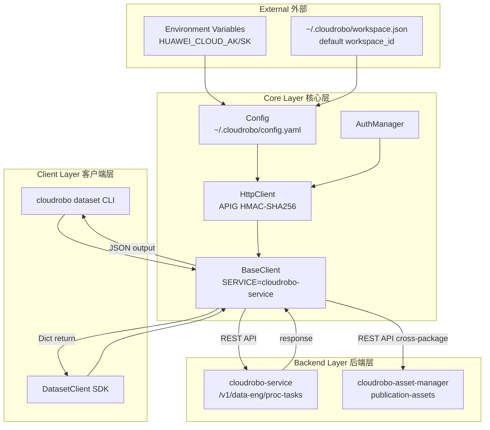
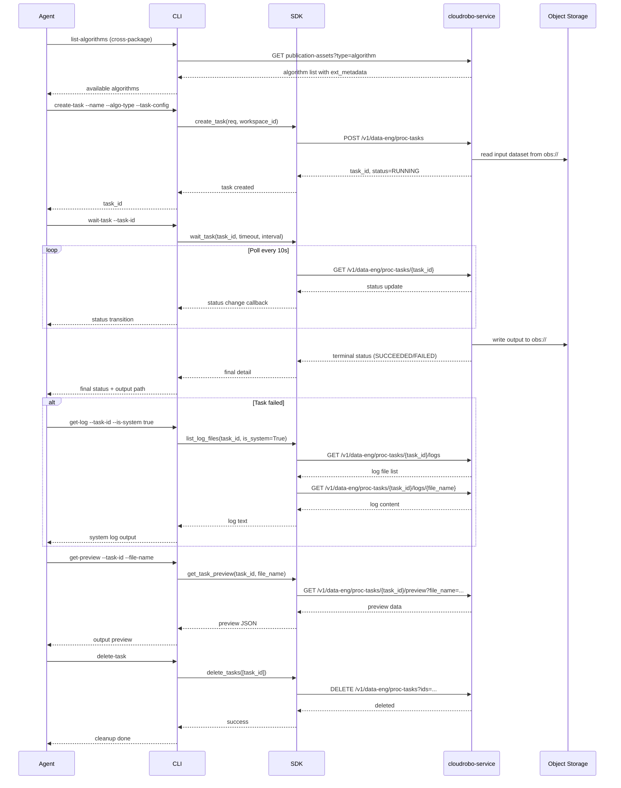
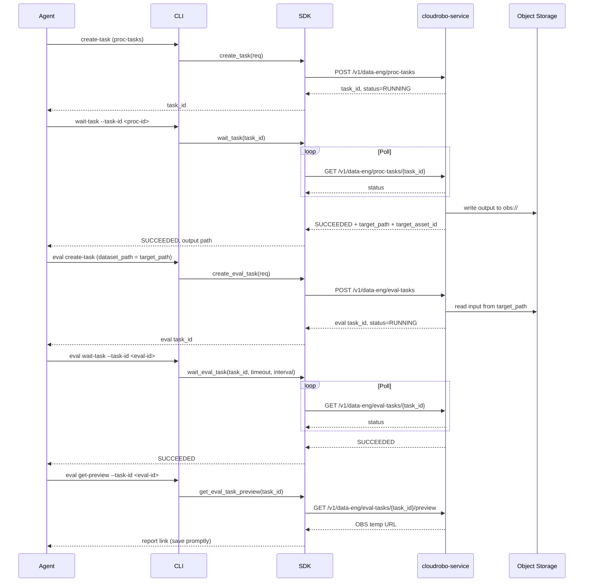

# Dataflow Diagram 数据流图

## Architecture Overview 架构概览



## Task Lifecycle Flow 任务生命周期流程



## Log Retrieval Flow 日志获取流程

```mermaid
flowchart TD
    A[Agent requests logs] --> B{is_system?}
    B -->|true| C[GET /logs?is_system=true]
    B -->|false| D[GET /logs?is_system=false]
    C --> E[Parse file_name + file_path]
    D --> E
    E --> F{--all flag?}
    F -->|no| G[get_task_log_tail<br/>latest 64KB]
    F -->|yes| H[get_task_log<br/>full content]
    G --> I[GET /logs/{file_name}<br/>start_byte=0&end_byte=65536]
    H --> J[GET /logs/{file_name}<br/>start_byte=0&end_byte=1000000]
    I --> K{total_size < 64KB?}
    K -->|yes| L[Return partial content]
    K -->|no| M[GET /logs/{file_name}<br/>start_byte=total-64KB]
    M --> L
    J --> L
    L --> N[Return log content to Agent]
```

## Pipeline Flow (proc-tasks → eval-tasks) 任务编排流程



## API Path Summary API路径汇总

### proc-tasks

| Operation | Method | Path |
|-----------|--------|------|
| Create task | POST | `/v1/data-eng/proc-tasks` |
| List tasks | GET | `/v1/data-eng/proc-tasks` |
| Show task | GET | `/v1/data-eng/proc-tasks/{task_id}` |
| Update task | PATCH | `/v1/data-eng/proc-tasks/{task_id}` |
| Delete tasks | DELETE | `/v1/data-eng/proc-tasks?ids=` |
| Copy task | POST | `/v1/data-eng/proc-tasks/{task_id}/copy` |
| List log files | GET | `/v1/data-eng/proc-tasks/{task_id}/logs` |
| Get log content | GET | `/v1/data-eng/proc-tasks/{task_id}/logs/{file_name}` |
| Download log | GET | `/v1/data-eng/proc-tasks/{task_id}/logs/{file_name}/download` |
| Get frames | GET | `/v1/data-eng/proc-tasks/{task_id}/frames?prefix=` |
| Get preview | GET | `/v1/data-eng/proc-tasks/{task_id}/preview` |
| Get resource usage | GET | `/v1/data-eng/proc-tasks/{task_id}/resource-usage` |
| Get events | GET | `/v1/data-eng/proc-tasks/{task_id}/events` |

### eval-tasks

| Operation | Method | Path |
|-----------|--------|------|
| Create eval task | POST | `/v1/data-eng/eval-tasks` |
| List eval tasks | GET | `/v1/data-eng/eval-tasks` |
| Show eval task | GET | `/v1/data-eng/eval-tasks/{task_id}` |
| Wait eval task (polled) | GET | `/v1/data-eng/eval-tasks/{task_id}` |
| Update eval task | PATCH | `/v1/data-eng/eval-tasks/{task_id}` |
| Delete eval task | DELETE | `/v1/data-eng/eval-tasks/{task_id}` |
| Copy eval task | POST | `/v1/data-eng/eval-tasks/{task_id}/copy` |
| List eval log files | GET | `/v1/data-eng/eval-tasks/{task_id}/logs` |
| Get eval log content | GET | `/v1/data-eng/eval-tasks/{task_id}/logs/{file_name}` |
| Download eval log | GET | `/v1/data-eng/eval-tasks/{task_id}/logs/{file_name}/download` |
| Get eval preview | GET | `/v1/data-eng/eval-tasks/{task_id}/preview` |
| Get eval events | GET | `/v1/data-eng/eval-tasks/{task_id}/events` |

### cloudrobo-asset-manager (assets — custom-operator onboarding & algorithm discovery)

Base URL: `https://cloudrobo-gallery.{region}.myhuaweicloud.com`. All paths are derived
from the SDK source code (`cloudrobo_asset/client.py`) via `_url()` calls — never
inferred. SDK source line references: `update_asset` (L43), `create_asset_version`
(L56), `list_asset_versions` (L59), `show_asset_version` (L62), `update_asset_version`
(L66). Verify with `grep "_url(" <cloudrobo_asset/client.py>`.

| Operation | Method | Path | SDK Method |
|-----------|--------|------|------------|
| Create asset (image / algorithm / dataset) | POST | `/v1/assets` | `AssetClient.create_asset(req)` |
| Update asset (algorithm `engine.image_url` / `code_dir`) | PUT | `/v1/assets/{asset_id}` | `AssetClient.update_asset(asset_id, req)` |
| Show asset | GET | `/v1/assets/{asset_id}` | `AssetClient.show_asset(asset_id)` |
| List assets | GET | `/v1/assets` | `AssetClient.list_assets(**params)` |
| Create asset version (image / dataset re-submission) | POST | `/v1/assets/{asset_id}/versions` | `AssetClient.create_asset_version(asset_id, req)` |
| List asset versions | GET | `/v1/assets/{asset_id}/versions` | `AssetClient.list_asset_versions(asset_id, **params)` |
| Show asset version | GET | `/v1/assets/{asset_id}/versions/{version_id}` | `AssetClient.show_asset_version(asset_id, version_id)` |
| Update asset version (`--status RELEASE`) | PUT | `/v1/assets/{asset_id}/versions/{version_id}` | `AssetClient.update_asset_version(asset_id, version_id, req)` |
| List predefined tags | GET | `/v1/asset-tags` | `AssetClient.list_all_tags(**params)` |

## Custom Operator Onboarding Data Flow 自定义算子入驻数据流

The custom-operator onboarding pipeline (SKILL.md §Custom Operator Onboarding) runs a
five-phase flow. The asset/version API paths above plus the proc-task/logs paths in
§API Path Summary are the audit reference for the pipeline.

```
PHASE 0: Deploy Mode & Assets      PHASE 1: Code Adaptation     PHASE 2: Build & Push (Mode A only)
┌──────────────────────────────┐  ┌────────────────────────┐  ┌──────────────────────┐
│ Ask customer: deploy mode   │  │ Create work copy       │─▶│ docker login (auto-  │
│  A = image-inbuilt (custom) │  │ Copy user code + sha256 │  │  generated from      │
│  B = OBS-mounted (preset)   │  │ Generate entrypoint.py │  │  AK/SK; fallback:    │
│  B → ask task-creation way: │  │ (never touch original) │  │  customer command)   │
│     空间资产-算法 use asset  │  └────────────────────────┘  │ docker build + tag + │
│     OBS算法 mount OBS code   │                              │ push (timestamp tag) │
│ Query image + algorithm     │                              │ Mode B: SKIP         │
│  assets (same-name + tag)   │                              └──────────┬───────────┘
     ▼
PHASE 3: Asset Registration (Mode A / Mode B 空间资产-算法 only)
┌────────────────────────────────────────────────────────────────┐   image_url writeback
│ Mode A / B-空间资产-算法 first: create-asset image + algorithm │
│   (algorithm engine: asset_id + asset_version_id link          │            ▼
│   the image asset; image_source=custom)                        │   operator_config.json
│ Mode A resub:     create-version + update-asset                │
│ Mode B-空间资产-算法 resub: update-asset (code_dir / image_url,│
│   keep asset_id/asset_version_id link)                         │   engine.image_url = SWR URL
│ Mode B OBS算法: ⛔ SKIP (no assets — redundant)               │
└──────────────────────────────────────────┬─────────────────────┘
                                           ▼
PHASE 4: Runtime Verification（proc-task）
┌──────────────────────────────────────────────────────────────────────────────────────┐
│ Ask input-dataset source: ① create NEW dataset from OBS (auto)                      │
│    create-asset type=dataset + create-version --url + update-version                 │
│    --status RELEASE                                                                  │
│    ② reuse existing workspace dataset (multi-select max 10)                         │
│ Mode A: WORKSPACE_ASSETS + algo_id → task runs image (custom)                        │
│ Mode B 空间资产-算法: WORKSPACE_ASSETS + algo_id (Phase 3 algorithm asset links      │
│    the image asset via engine.asset_id + engine.asset_version_id,                    │
│    image_source=custom) + algo_path (=asset code_dir) + job_local_path →             │
│    task links the asset and mounts its code_dir (truly uses the created              │
│    algorithm)                                                                        │
│ Mode B OBS算法: OBS_ASSETS + algo_path + job_local_path (no algo_id) →               │
│    task mounts code_dir directly                                                     │
│ Verify: job-std-output.log `[DONE] ...` + get-frames non-empty                       │
│ FAILED → custom-operator/custom-operator-workflow.md (P0/P1/P2/P3)                   │
└──────────────────────────────────────────────────────────────────────────────────────┘
     │
     ▼
Cleanup & report: server-side local junk (always) → platform junk (confirmed)
→ verification-report.md (offered)
```

Runtime injection (during task execution, by platform):

```
Platform                     Container                    Output
SOURCE_DATASET_PATH ──▶ entrypoint.py ──▶ /output/
= JSON map (multi-     reads env var →     dataset
dataset, max 10)       INPUT_DIR → calls
                       user's process()
```
