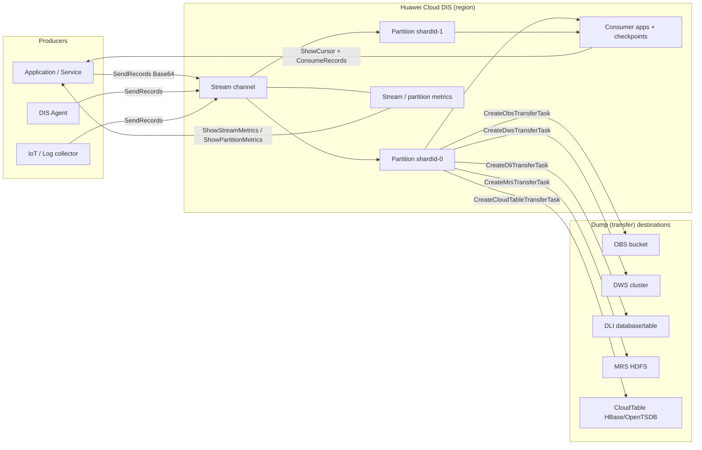

# DIS Data Flow

## Operational flow

1. Producers write records into a stream (`SendRecords`, Base64 payloads).
2. DIS distributes records across partitions using `partition_id`,
   `partition_key`, or `explicit_hash_key`.
3. Dump tasks asynchronously deliver stream data to one of the five destinations
   through the DIS agency.
4. Consumer apps read records with a cursor (`ShowCursor` -> `ConsumeRecords`)
   and persist progress with checkpoints (`CommitCheckpoint`).
5. Monitoring reads throughput, latency, success-rate, and throttling series
   from stream and partition metric APIs; consumer state exposes committed
   sequence numbers for lag assessment.

## Management boundaries

- The skill manages DIS streams, dump tasks, apps, checkpoints, policies, and
  tags only. It does not write to the destination systems on the user's behalf;
  it configures DIS to do so through the agency.
- Deleting a stream does not delete data already dumped to OBS/DWS/DLI/MRS/
  CloudTable.
- IAM policy changes and OBS object content changes are out of scope.