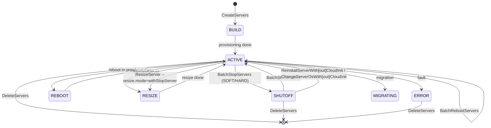

# Data Flow Diagram

## ECS Lifecycle Management — End-to-End Flow

```mermaid
flowchart TD
    P0[Step 0 Preflight<br/>scripts/preflight_check.sh<br/>hcloud on PATH? version?<br/>credentials? region?] --> P1{Environment Ready?}
    P1 -->|No| P2[Print installation / authentication<br/>guidance and ABORT]
    P1 -->|Yes| A[User Request]
    A --> B{Request Type?}
    B -->|Knowledge Q&A| C[Answer from FAQ / official docs]
    B -->|Query| D[Build query filters]
    B -->|Mutating Op| E[Resolve server_id + params]

    D --> F[hcloud ECS ListServersDetails / ShowServer /<br/>ListResizeFlavors]
    F --> G[Format & present instance info]

    E --> H{User Confirmed?}
    H -->|No| I[Cancel — no change]
    H -->|Yes| Q{Which change?}
    Q -->|Resize| DR[Pre-check: ResizeServer --dry_run=true]
    Q -->|Reinstall / Change OS| ST[Stop server first via BatchStopServers<br/>or pass mode=withStopServer]
    Q -->|Other| J
    DR --> J[Execute hcloud ECS operation]
    ST --> J
    J --> J1[CreateServers / DeleteServers /<br/>BatchStartServers / BatchStopServers /<br/>BatchRebootServers / BatchUpdateServersName /<br/>ReinstallServerWith[out]CloudInit /<br/>ChangeServerOsWith[out]CloudInit /<br/>ResizeServer / ResizePostPaidServer /<br/>BatchResizeServers]
    J1 -->|CLI fails| K[Fallback: huaweicloudsdkecs SDK]

    J1 --> L[Return result / job id]
    K --> L
    L --> M[Suggest verification via ShowServer / ListServersDetails]
    M --> N[Quality report via skill_quality_sdk]
```

## Instance Lifecycle State Machine

