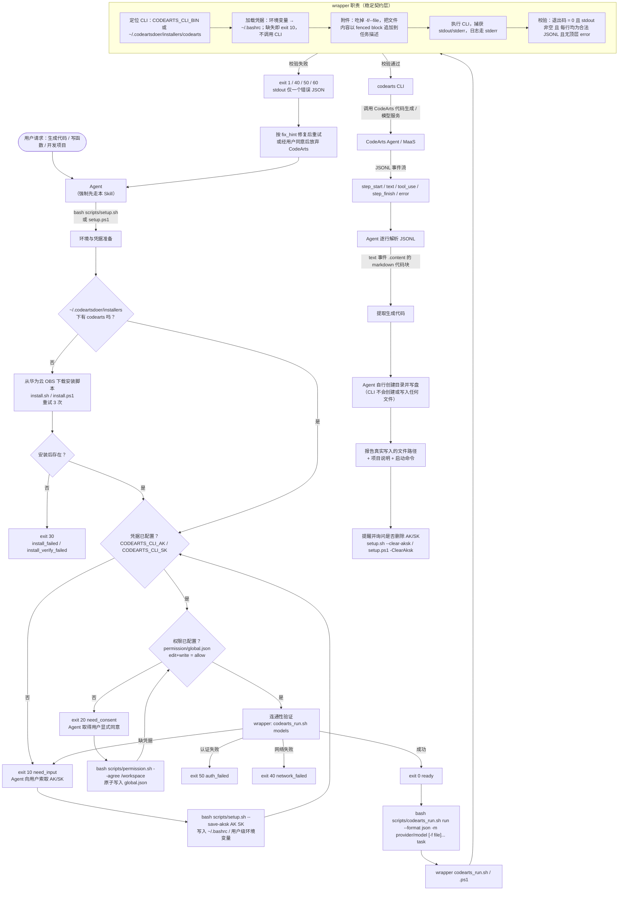

# Data Flow Diagram（数据流图）

> 本 skill 的数据流：**Agent → 环境与授权准备（`setup.*` / `permission.*`）→ wrapper（`codearts_run.*`）→ `codearts` CLI → CodeArts Agent / 模型服务 → JSONL 事件 → Agent 解析并落盘**。
> 图中每个节点的输出都遵循同一套退出码与 stdout 契约（见文末表格）。

---

## 1. 端到端数据流

---

## 2. 说明（3 句）

1. **准备阶段是三道前置门**：`setup.sh` / `setup.ps1` 依次完成 CLI 安装、凭据、权限三项检查，任一项不满足就以对应的结构化 JSON + 专属退出码（`30` / `10` / `20`）中断，由 Agent 向用户索取输入或同意，而不是把失败当成成功继续往下走。
2. **wrapper 是唯一的契约层**：`codearts_run.sh` / `codearts_run.ps1` 负责定位 CLI、加载凭据、把 `-f` 附件以 fenced block 追加到任务描述，并强制「退出码 0 + stdout 非空 + 逐行合法 JSONL」的成功判据；任何失败都映射为唯一的错误 JSON 与非零退出码（`1 / 10 / 30 / 40 / 50 / 60`），**绝不 `exit 0`**。
3. **落盘由 Agent 负责**：`codearts run --format json` 只返回 JSONL 事件流，生成的代码位于 `text` 事件的 markdown 代码块中，CLI **不会创建或写入任何文件**；Agent 必须自己创建父目录、写入代码，并只报告确实写入过的路径（任务描述里的 `Output:` 只是提示）。

---

## 3. 契约速查

| 阶段 | 产出 | 退出码 |
|------|------|--------|
| `setup.sh` / `setup.ps1`（参数校验） | `{"status":"error","code":2,"type":"invalid_arguments"\|"empty_credentials"\|"lock_timeout"}` | `2` |
| CLI 安装 | `download_failed` / `install_failed` / `install_verify_failed` / `dependency_missing` / `unsupported_os` | `30` |
| 凭据检查 | `{"status":"need_input","code":10,"type":"aksk_required",...}` | `10` |
| 权限检查 | `{"status":"need_consent","code":20,"type":"permission_required",...}` | `20` |
| 连通性检查 | `ready` / `auth_failed` / `network_failed` | `0` / `50` / `40` |
| `permission.sh --agree` | `PERMISSION_CONFIGURED` + `global.json` 绝对路径 | `0`（拒绝或参数错误 `1`） |
| 凭据清理 | `{"status":"cleared","code":0,"message":"AK/SK removed from ~/.bashrc"}` | `0` |
| wrapper 成功 | CLI 的 stdout 原样透传（JSONL） | `0` |
| wrapper 失败 | stdout 有且仅有一个 `{"status":"error","code":N,"type":"...","message":"...","fix_hint":"..."}`；日志在 stderr（前缀 `[codearts_run]`） | `1` / `10` / `30` / `40` / `50` / `60` |

---

## 4. 关键数据落点

| 数据 | 位置 | 写入方 |
|------|------|--------|
| `codearts` 可执行文件 | `~/.codeartsdoer/installers/codearts`（Windows：`codearts.cmd`） | 官方安装脚本（由 `setup.*` 触发） |
| AK/SK | `~/.bashrc` 的 `export CODEARTS_CLI_AK/SK=`（Windows：用户级环境变量） | `setup.sh` / `setup.ps1`（含清理命令） |
| 权限配置 | `~/.codeartsdoer/cli-data/storage/permission/global.json` | `permission.sh` / `permission.ps1`（原子替换） |
| 代码生成结果 | 由 **Agent** 写入工作区内的目标路径 | Agent（CLI 不写文件） |
| 临时文件 | wrapper 的私有工作目录（stdout / stderr 捕获） | `codearts_run.*` |
