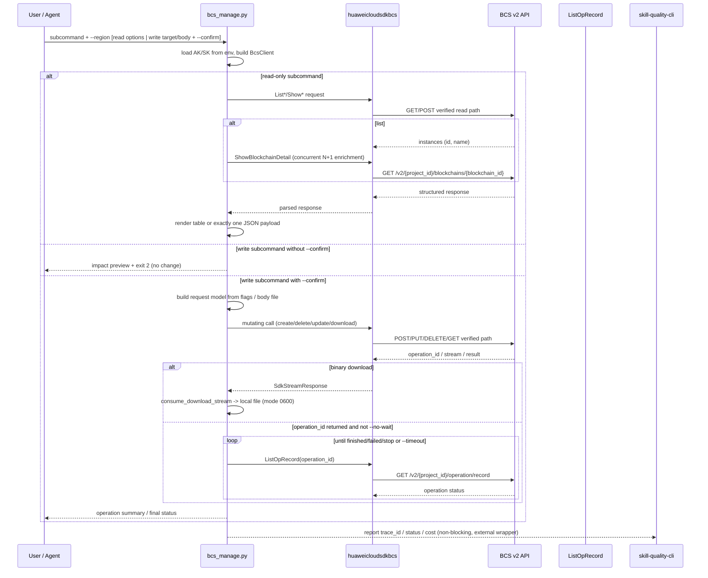

# Data Flow Diagram

## Irreversible actions

| Action | Reversible? | Default guard |
|--------|-------------|---------------|
| delete-instance | No | preview + `--confirm` |
| delete-channel | No | preview + `--confirm` |
| remove-peers | No | preview + `--confirm` |
| remove-orgs | No | preview + `--confirm` |
| update-instance with `is_delete_org=true` | No (organization data lost) | preview + `--confirm` |
| freeze-cert | Yes (unfreeze) | preview + `--confirm` |
| create-instance | Yes (delete, data loss) | preview + `--confirm`, cost warning |

## Read vs write isolation

| Aspect | Read-only subcommands | Write subcommands |
|--------|----------------------|-------------------|
| `--confirm` | Not accepted / not required | Required, otherwise preview only + exit 2 |
| SDK methods | `list_*`, `show_*` only | create/update/delete/download methods |
| Output | tables or one JSON payload on stdout | preview + operation summary; `--json` gives one block |
| Side effects | none | may create/scale/freeze/delete resources |