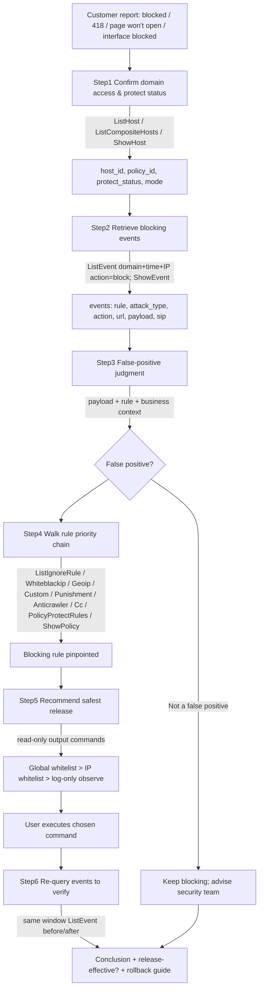

# Data Flow Diagram

## Key Decision Branch: False-Positive Judgment

- Normal business params hit semantic character groups (select/limit → sqli), static/framework paths look like attack payloads, known security/scanner UA, cloud/vendor egress IP vs iprank/geo rules → suspect false positive.
- Follow the rule priority chain to pinpoint which rule produced `action=block`.

## Rule Priority Chain (for release-method recommendation)

误报屏蔽/全局白名单 (IgnoreRule) → IP 白名单 (WhiteblackipRule white=1) → IP 黑名单 (white=0) → 地理位置封禁 (GeoipRule) → 精准防护 (CustomRule) → 攻击惩罚 (PunishmentRule) → 动态反爬 (AnticrawlerRule) → CC 防护 (CcRule) → Web 基础防护 (ListWebBasicProtectionRules).

Always recommend the highest-priority entry that covers the blocking feature; never recommend disabling web basic protection first.