# Data Flow Diagram

```mermaid
graph TD
    User[User / Agent] --> Router{Action Router}

    Router -->|DDS Actions| DDS_CLI[hcloud DDS CLI]
    Router -->|DCS Actions - CLI primary| DCS_CLI[hcloud DCS CLI]
    Router -.->|DCS Actions - SDK fallback, optional| DCS_SDK[huaweicloudsdkdcs SDK]

    DDS_CLI --> DDS_List[List DDS Instances]
    DDS_CLI --> DDS_Get[Get DDS Instance]
    DDS_CLI --> DDS_Create[Create DDS Instance]
    DDS_CLI --> DDS_AddReadonly[Add ReadOnly Node]
    DDS_CLI --> DDS_AddSharding[Add Sharding Node]
    DDS_CLI --> DDS_Backup[Create Backup]
    DDS_CLI --> DDS_Delete[Delete Instance]
    DDS_CLI --> DDS_Analyze[Deployment Analysis]

    DCS_CLI --> DCS_List[List DCS Instances]
    DCS_CLI --> DCS_Show[Get DCS Instance]
    DCS_CLI --> DCS_Delete[Delete DCS Instance]
    DCS_CLI --> DCS_Restart[Restart DCS Instance]
    DCS_CLI --> DCS_Nodes[Get Node Information]
    DCS_CLI --> DCS_Templates[List / Create Config Templates]
    DCS_CLI --> DCS_Create[Create DCS Instance]
    DCS_CLI --> DCS_Analyze[Security Analysis]

    DCS_SDK -.-> SDK_Nodes[Get Node Information]
    DCS_SDK -.-> SDK_Templates[List / Create Config Templates]
    DCS_SDK -.-> SDK_Create[Create DCS Instance]

    DDS_List & DDS_Get & DDS_Create & DDS_AddReadonly --> DDS_API[Huawei Cloud DDS API]
    DDS_AddSharding & DDS_Backup & DDS_Delete & DDS_Analyze --> DDS_API

    DCS_List & DCS_Show & DCS_Delete & DCS_Restart & DCS_Nodes & DCS_Templates & DCS_Create & DCS_Analyze --> DCS_API[Huawei Cloud DCS API]

    DDS_API --> DDS_Result[Query Results / Operation Status]
    DCS_API --> DCS_Result[Query Results / Operation Status]

    DDS_Result & DCS_Result --> Formatter[Result Formatter]
    Formatter --> User

    subgraph Authentication
        Env_AK[AK/SK env vars: HUAWEI_ACCESS_KEY/HUAWEI_SECRET_KEY or HWC_AK/HWC_SK] --> hcloud_Profile[hcloud CLI Profile]
        SDK_Creds[SDK credentials: HUAWEICLOUD_SDK_AK / HUAWEICLOUD_SDK_SK] --> DCS_SDK
        hcloud_Profile --> DDS_CLI
        hcloud_Profile --> DCS_CLI
    end
```

## Execution Flow

1. **Action Router** receives the request and determines the target service (DDS/DCS) and the
   operation severity (R3 query / R2 management / R1 destructive).
2. **CLI execution is primary** for both services: all DDS operations plus every documented DCS
   operation — list/show/delete/restart instances, node information, list/create config templates,
   and create instance — run as `hcloud DDS ...` / `hcloud DCS ...`.
3. **SDK fallback (optional)** is used only when the CLI path is unavailable, for DCS node
   information, config templates (list/create) and instance creation. The SDK cannot read the
   encrypted AK/SK from the hcloud profile, so it requires `HUAWEICLOUD_SDK_AK` /
   `HUAWEICLOUD_SDK_SK` to be set first.
4. **Huawei Cloud API** processes the request and returns results.
5. **Result Formatter** normalizes output for the user/agent.

## Authentication Flow

- CLI operations authenticate through the hcloud profile (configured with `hcloud configure`) or
  through `HUAWEI_ACCESS_KEY`/`HUAWEI_SECRET_KEY` (or legacy `HWC_AK`/`HWC_SK`) environment
  variables.
- SDK fallback operations authenticate with `HUAWEICLOUD_SDK_AK` / `HUAWEICLOUD_SDK_SK`
  (see `references/cli-installation-guide.md`); the hcloud profile credentials are not readable by
  the SDK.
- No hardcoded credentials in any script or configuration file.
