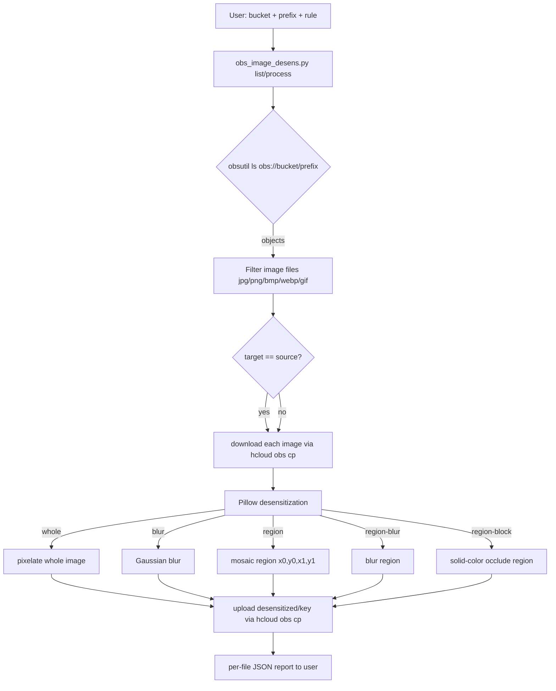
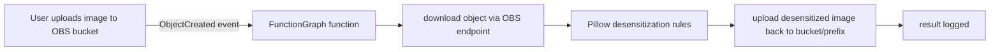

# Data Flow Diagram

## Batch desensitization flow (`list` + `process`)

## Automatic on-upload flow (`setup-trigger`)

## Component mapping

| Step | Tool | Notes |
| ------ | ------ | ------- |
| List objects | obsutil via `hcloud obs ls` | filter by prefix + image extensions |
| Download | obsutil via `hcloud obs cp` | temp dir per run |
| Desensitize | Pillow (PIL) | mosaic / Gaussian blur / region occlude |
| Upload | obsutil via `hcloud obs cp` | target bucket/prefix, default `desensitized/` |
| Automation | huaweicloudsdkfunctiongraph | CreateFunction + CreateFunctionTrigger (OBS) |
