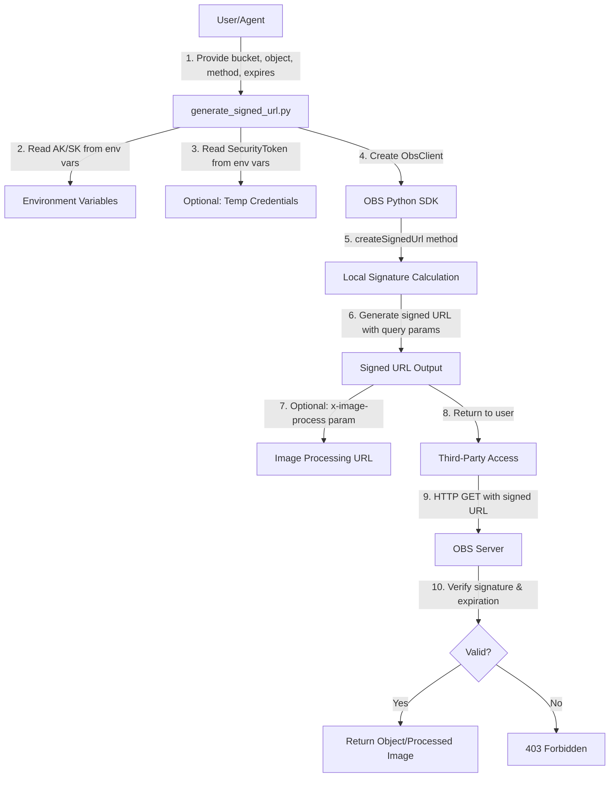
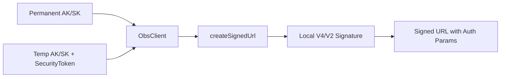

# Data Flow Diagram

## OBS Signed URL Generation Flow



## Authentication Flow



## Image Processing Flow

```mermaid
flowchart TD
    A[Image Processing Request] --> B{Processing Type}
    B -->|Resize| C[image/resize,w_X,h_Y]
    B -->|Crop| D[image/crop,w_X,h_Y,g_pos]
    B -->|Rotate| E[image/rotate,angle]
    B -->|Compress| F[image/quality,q_X]
    B -->|Watermark| G[image/watermark,text_X]
    B -->|Format| H[image/format,fmt]
    B -->|Composite| I[image/resize...|image/quality...]
    C --> J[x-image-process query param]
    D --> J
    E --> J
    F --> J
    G --> J
    H --> J
    I --> J
    J --> K[createSignedUrl with queryParams]
    K --> L[Signed Image Processing URL]
```
